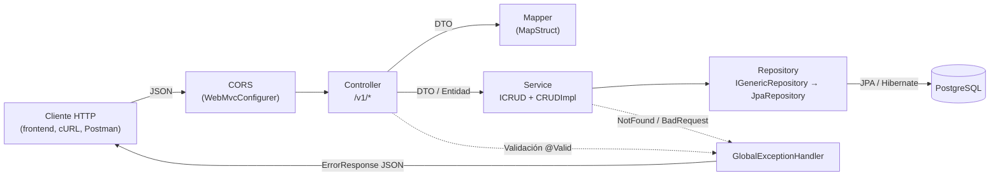
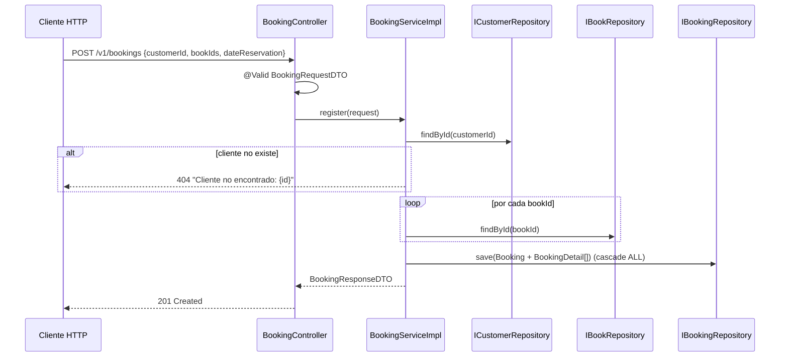
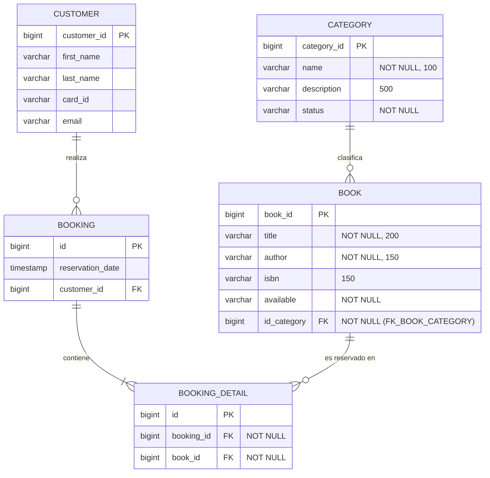

# library-backend

API REST para la gestión de una biblioteca: categorías, libros, clientes y reservas de libros.

- **Grupo / artefacto:** `com.lekasoft:library-backend`
- **Versión:** `0.0.1-SNAPSHOT`
- **Clase principal:** `com.lekasoft.LibraryBackendApplication`

---

## Tabla de contenido

1. [Información general](#1-información-general)
2. [Arquitectura del proyecto](#2-arquitectura-del-proyecto)
3. [Requisitos previos](#3-requisitos-previos)
4. [Configuración de variables de entorno](#4-configuración-de-variables-de-entorno)
5. [Instalación y ejecución](#5-instalación-y-ejecución)
6. [Documentación de endpoints REST](#6-documentación-de-endpoints-rest)
7. [Base de datos](#7-base-de-datos)
8. [Pruebas](#8-pruebas)
9. [Consideraciones para despliegue](#9-consideraciones-para-despliegue)
10. [Observaciones y pendientes](#10-observaciones-y-pendientes)

---

## 1. Información general

### 1.1 Descripción y objetivo

`library-backend` es un backend Spring Boot que expone una API REST versionada (`/v1/...`) para administrar el catálogo de una biblioteca y registrar reservas de libros por parte de clientes. Persiste la información en PostgreSQL mediante Spring Data JPA.

### 1.2 Funcionalidades principales

| Módulo | Funcionalidad |
|---|---|
| Categorías | CRUD completo (`/v1/categories`), con validación de entrada. |
| Libros | CRUD completo (`/v1/books`). Cada libro pertenece a una categoría existente (se valida por `categoryId`). |
| Clientes | CRUD completo (`/v1/customers`). |
| Reservas | Registro de una reserva de uno o varios libros para un cliente, listado de todas las reservas y listado por cliente (`/v1/bookings`). |
| Errores | Manejo global de excepciones con un cuerpo de error uniforme (`ErrorResponse`). |
| CORS | Habilitado para cualquier origen (`util/CORS.java`). |

### 1.3 Tecnologías y versiones

Versiones tomadas de `pom.xml` y `.mvn/wrapper/maven-wrapper.properties`:

| Tecnología | Versión | Uso |
|---|---|---|
| Java | **25** (`java.version`) | Lenguaje |
| Spring Boot | **4.1.1** (`spring-boot-starter-parent`) | Framework base |
| spring-boot-starter-webmvc | gestionada por Spring Boot | API REST (Spring MVC) |
| spring-boot-starter-data-jpa | gestionada por Spring Boot | Persistencia JPA / Hibernate |
| spring-boot-starter-validation | gestionada por Spring Boot | Bean Validation (`@Valid`, `jakarta.validation`) |
| PostgreSQL JDBC driver | gestionada por Spring Boot (scope `runtime`) | Conexión a la base de datos |
| Lombok | **1.18.48** (scope `provided`) | Reducción de código repetitivo |
| MapStruct | **1.6.3** | Mapeo entidad ↔ DTO |
| lombok-mapstruct-binding | **0.2.0** | Integración Lombok + MapStruct en el procesador de anotaciones |
| spring-boot-starter-webmvc-test | gestionada por Spring Boot (scope `test`) | JUnit Jupiter, Mockito, AssertJ, MockMvc |
| Maven (wrapper) | **3.9.16** (wrapper 3.3.4) | Build |

---

## 2. Arquitectura del proyecto

### 2.1 Descripción

Arquitectura **en capas** (monolito Spring Boot) con separación clásica:

`Controller → Service (interfaz + impl) → Repository → Model (entidad JPA)`

Los controladores reciben y devuelven **DTOs**; la conversión entre DTO y entidad se hace con **mappers MapStruct**. Los servicios heredan de una implementación CRUD genérica (`CRUDImpl<T, ID>`) que trabaja sobre un repositorio genérico (`IGenericRepository<T, ID>`, que extiende `JpaRepository`).

### 2.2 Organización de paquetes

```text
src/main/java/com/lekasoft
├── LibraryBackendApplication.java   # Punto de entrada (@SpringBootApplication)
├── controller/                      # Controladores REST
│   ├── BookController.java          #   /v1/books
│   ├── BookingController.java       #   /v1/bookings
│   ├── CategoryController.java      #   /v1/categories
│   └── CustomerController.java      #   /v1/customers
├── dto/                             # Contratos de entrada/salida
│   ├── BookDTO.java
│   ├── BookingRequestDTO.java
│   ├── BookingResponseDTO.java
│   ├── CategoryDTO.java
│   └── CustomerDTO.java
├── exception/                       # Excepciones y manejador global
│   ├── BadRequestException.java
│   ├── ErrorResponse.java
│   ├── GlobalExceptionHandler.java
│   └── NotFoundException.java
├── mapper/                          # Mappers MapStruct (componentModel = "spring")
├── model/                           # Entidades JPA: Book, Booking, BookingDetail, Category, Customer
├── repository/                      # Repositorios Spring Data JPA
│   └── IGenericRepository.java      #   @NoRepositoryBean base
├── service/                         # Interfaces de servicio (ICRUD<T,ID> + específicas)
│   └── impl/                        # Implementaciones (CRUDImpl abstracta + servicios)
└── util/
    └── CORS.java                    # Configuración CORS global (WebMvcConfigurer)

src/main/resources
├── application.yaml                 # Configuración de Spring (datasource, JPA)
└── env.env                          # Valores de las variables de entorno de BD (ver sección 4)
```

### 2.3 Responsabilidad de los componentes

| Componente | Responsabilidad |
|---|---|
| `controller` | Expone endpoints, valida el body con `@Valid` (salvo `CustomerController`), delega en servicios y arma la `ResponseEntity`. |
| `dto` | Define los contratos JSON y sus restricciones de validación. |
| `mapper` | Convierte entre entidades y DTOs. `BookMapper` transforma `category` (entidad) ↔ `categoryId` (Long). `BookingMapper` compone `customerName` y `bookTitles`. |
| `service` / `service.impl` | Lógica de negocio. `CRUDImpl` implementa `save`, `update`, `findAll`, `findById`, `delete`; lanza `NotFoundException` si no existe el registro. `BookServiceImpl` resuelve la categoría; `BookingServiceImpl` arma la reserva y sus detalles en una transacción. |
| `repository` | Acceso a datos con Spring Data JPA. `IBookingRepository` usa `@EntityGraph` para cargar cliente y libros en una sola consulta. |
| `model` | Entidades JPA mapeadas a tablas PostgreSQL. |
| `exception` | `GlobalExceptionHandler` (`@RestControllerAdvice`) traduce `NotFoundException` → 404, `BadRequestException` → 400 y errores de validación → 400. |
| `util.CORS` | Permite cualquier origen y los métodos `GET, POST, PUT, DELETE, PATCH, OPTIONS`. |

### 2.4 Flujo entre capas





---

## 3. Requisitos previos

| Herramienta | Versión | Notas |
|---|---|---|
| JDK | **25** | Obligatorio: `pom.xml` define `<java.version>25</java.version>`. Configurar `JAVA_HOME`. |
| Maven | **3.9.16** (vía wrapper) | No es necesario instalarlo: usar `./mvnw` (Linux/macOS) o `mvnw.cmd` (Windows). |
| PostgreSQL | No especificada en el proyecto | Se requiere un servidor accesible y una base de datos creada previamente. |
| Git | Cualquiera reciente | Para clonar el repositorio. |
| IDE (opcional) | — | Si se usa IntelliJ/Eclipse, habilitar el procesamiento de anotaciones (Lombok y MapStruct). |

---

## 4. Configuración de variables de entorno

`src/main/resources/application.yaml` construye la conexión a la base de datos a partir de **cinco variables de entorno**:

```yaml
spring:
  datasource:
    url: jdbc:postgresql://${DB_HOST}:${DB_PORT}/${DB_NAME}
    username: ${DB_USER}
    password: ${DB_PASS}
```

### 4.1 Variables

| Variable | Descripción | Valor de ejemplo | Obligatoria |
|---|---|---|---|
| `DB_HOST` | Servidor (host) de PostgreSQL | `localhost` | Sí |
| `DB_PORT` | Puerto de PostgreSQL | `5432` | Sí |
| `DB_NAME` | Nombre de la base de datos | `library_db` | Sí |
| `DB_USER` | Usuario de conexión | `library_user` | Sí |
| `DB_PASS` | Contraseña del usuario | `********` | Sí |

Las cinco variables corresponden a la **conexión con la base de datos**. El proyecto **no** usa variables para servicios externos, URLs de terceros, tokens ni credenciales adicionales. El puerto HTTP no se configura, así que se usa el valor por defecto de Spring Boot (`8080`).

> [!IMPORTANT]
> **Antes de ejecutar el proyecto, modifique estas variables.** Los valores de ejemplo de este documento son ficticios y deben reemplazarse por los de su entorno (host, puerto, nombre de base de datos, usuario y contraseña de **su** PostgreSQL). Si alguna variable no está definida, la aplicación no podrá resolver los placeholders `${...}` y fallará al arrancar.

### 4.2 Archivo `env.env`

El proyecto incluye `src/main/resources/env.env` con las cinco variables anteriores. Tenga en cuenta:

- **Spring Boot no carga este archivo automáticamente.** `application.yaml` no tiene `spring.config.import` ni otro mecanismo que lo lea. Las variables deben llegar al proceso por otra vía: exportadas en la terminal, en la configuración de ejecución del IDE (p. ej. el plugin *EnvFile* de IntelliJ) o en el entorno del servidor.
- **No existe un archivo `.env.example`.** Use la plantilla de la sección 4.3.
- **`env.env` no está excluido en `.gitignore`** y queda dentro de `src/main/resources`, por lo que se empaqueta en el JAR. Ver la sección [10](#10-observaciones-y-pendientes).

### 4.3 Plantilla (valores ficticios)

```dotenv
# Conexión a PostgreSQL. Reemplace TODOS los valores por los de su entorno.
DB_HOST=localhost
DB_PORT=5432
DB_NAME=library_db
DB_USER=library_user
DB_PASS=cambie_esta_clave
```

### 4.4 Cómo definir las variables

**Linux / macOS (bash/zsh):**

```bash
export DB_HOST=localhost
export DB_PORT=5432
export DB_NAME=library_db
export DB_USER=library_user
export DB_PASS=cambie_esta_clave

# O, a partir de un archivo con el formato de la plantilla:
set -a; source src/main/resources/env.env; set +a
```

**Windows (PowerShell):**

```powershell
$env:DB_HOST="localhost"
$env:DB_PORT="5432"
$env:DB_NAME="library_db"
$env:DB_USER="library_user"
$env:DB_PASS="cambie_esta_clave"
```

**IntelliJ IDEA:** *Run/Debug Configurations → Environment variables*, o cargar el archivo con el plugin EnvFile.

---

## 5. Instalación y ejecución

### 5.1 Clonar el repositorio e ingresar al directorio

```bash
git clone <URL_DEL_REPOSITORIO>
cd library-backend
```

> La URL del repositorio no está en el proyecto. Reemplace `<URL_DEL_REPOSITORIO>` por la que corresponda.

### 5.2 Instalar dependencias y compilar

```bash
# Linux / macOS
./mvnw clean compile

# Windows
mvnw.cmd clean compile
```

La compilación ejecuta los procesadores de anotaciones de Lombok y MapStruct; los mappers generados quedan en `target/generated-sources/annotations`.

### 5.3 Configurar las variables de entorno

Ver la [sección 4](#4-configuración-de-variables-de-entorno).

### 5.4 Preparar la base de datos

1. Cree la base de datos y el usuario en PostgreSQL (ejemplo con valores ficticios):

   ```sql
   CREATE USER library_user WITH PASSWORD 'cambie_esta_clave';
   CREATE DATABASE library_db OWNER library_user;
   ```

2. **No hay scripts SQL ni migraciones** (no se usa Flyway ni Liquibase). Las tablas se crean y actualizan automáticamente al arrancar gracias a `spring.jpa.hibernate.ddl-auto: update`.

### 5.5 Ejecutar en local

```bash
./mvnw spring-boot:run          # Linux / macOS
mvnw.cmd spring-boot:run        # Windows
```

La API queda disponible en `http://localhost:8080`.

### 5.6 Generar el artefacto de producción

```bash
./mvnw clean package            # ejecuta las pruebas (ver la sección 8.3)
./mvnw clean package -DskipTests

java -jar target/library-backend-0.0.1-SNAPSHOT.jar
```

---

## 6. Documentación de endpoints REST

**URL base:** `http://localhost:8080`

**Autenticación / autorización:** el proyecto **no implementa** ningún mecanismo (no incluye Spring Security, JWT ni filtros). **Todos los endpoints son públicos.**

**Headers:** para las peticiones con body, `Content-Type: application/json`. No se requieren otros headers.

### 6.1 Resumen

| Método | Endpoint | Descripción | Parámetros | Éxito | Auth |
|---|---|---|---|---|---|
| GET | `/v1/categories` | Listar categorías | — | 200 | No |
| GET | `/v1/categories/{id}` | Obtener una categoría | `id` (path) | 200 | No |
| POST | `/v1/categories` | Registrar una categoría | Body `CategoryDTO` | 200 | No |
| PUT | `/v1/categories/{id}` | Actualizar una categoría | `id`, Body `CategoryDTO` | 200 | No |
| DELETE | `/v1/categories/{id}` | Eliminar una categoría | `id` | 204 | No |
| GET | `/v1/books` | Listar libros | — | 200 | No |
| GET | `/v1/books/{id}` | Obtener un libro | `id` | 200 | No |
| POST | `/v1/books` | Registrar un libro | Body `BookDTO` | 200 | No |
| PUT | `/v1/books/{id}` | Actualizar un libro | `id`, Body `BookDTO` | 200 | No |
| DELETE | `/v1/books/{id}` | Eliminar un libro | `id` | 204 | No |
| GET | `/v1/customers` | Listar clientes | — | 200 | No |
| GET | `/v1/customers/{id}` | Obtener un cliente | `id` | 200 | No |
| POST | `/v1/customers` | Registrar un cliente | Body `CustomerDTO` | 200 | No |
| PUT | `/v1/customers/{id}` | Actualizar un cliente | `id`, Body `CustomerDTO` | 200 | No |
| DELETE | `/v1/customers/{id}` | Eliminar un cliente | `id` | 204 | No |
| POST | `/v1/bookings` | Registrar una reserva | Body `BookingRequestDTO` | **201** | No |
| GET | `/v1/bookings` | Listar todas las reservas | — | 200 | No |
| GET | `/v1/bookings/customer/{customerId}` | Reservas de un cliente | `customerId` (path) | 200 | No |

Ningún endpoint usa parámetros de consulta (`@RequestParam`).

### 6.2 Formato de error

`GlobalExceptionHandler` devuelve este cuerpo:

```json
{
  "timestamp": "2026-11-06T10:15:30.123",
  "status": 404,
  "error": "Not Found",
  "message": "Registro no encontrado: 99",
  "path": "/v1/categories/99"
}
```

| Excepción | Código | `message` |
|---|---|---|
| `NotFoundException` | 404 | p. ej. `Registro no encontrado: {id}`, `Libro no encontrado: {id}`, `Categoría no encontrada: {id}`, `Cliente no encontrado: {id}` |
| `BadRequestException` | 400 | p. ej. `Debe indicar al menos un libro` |
| `MethodArgumentNotValidException` (`@Valid`) | 400 | `campo: mensaje` por cada error, separados por `, ` |

Las demás excepciones (JSON mal formado, violaciones de integridad en la base de datos, etc.) no tienen manejador propio y usan la respuesta por defecto de Spring Boot (p. ej. 400 o 500).

---

### 6.3 Categorías — `/v1/categories`

**`CategoryDTO`**

| Campo | Tipo | Reglas |
|---|---|---|
| `categoryId` | Long | Generado por la base de datos. |
| `name` | String | Obligatorio (`@NotBlank`), máx. 100 caracteres. |
| `description` | String | Opcional, máx. 500 caracteres. |
| `status` | String | Obligatorio (`@NotBlank`). Texto libre; no hay valores restringidos en el código. |

#### GET `/v1/categories`
Lista todas las categorías. **200** con `CategoryDTO[]`.

```bash
curl -X GET http://localhost:8080/v1/categories
```

#### GET `/v1/categories/{id}`
- **Path:** `id` (Long)
- **200** con `CategoryDTO` · **404** si no existe.

```bash
curl -X GET http://localhost:8080/v1/categories/1
```

#### POST `/v1/categories`
- **Body:**

```json
{
  "name": "Programación",
  "description": "Libros de desarrollo de software",
  "status": "ACTIVO"
}
```

- **200** con la categoría creada · **400** por validación.

```bash
curl -X POST http://localhost:8080/v1/categories \
  -H "Content-Type: application/json" \
  -d '{"name":"Programación","description":"Libros de desarrollo de software","status":"ACTIVO"}'
```

Respuesta:

```json
{
  "categoryId": 1,
  "name": "Programación",
  "description": "Libros de desarrollo de software",
  "status": "ACTIVO"
}
```

#### PUT `/v1/categories/{id}`
- **Path:** `id` (Long) · **Body:** `CategoryDTO`
- **200** con la categoría actualizada · **400** por validación · **404** si el `id` no existe.

> [!WARNING]
> El servicio solo usa el `id` de la ruta para comprobar que el registro existe. El valor que se guarda es el `categoryId` del **body**. **Incluya `categoryId` en el body con el mismo valor que el `id` de la ruta**; si lo omite, se creará un registro nuevo en vez de actualizar el existente.

```bash
curl -X PUT http://localhost:8080/v1/categories/1 \
  -H "Content-Type: application/json" \
  -d '{"categoryId":1,"name":"Programación","description":"Actualizada","status":"INACTIVO"}'
```

#### DELETE `/v1/categories/{id}`
- **204 No Content.** Spring Data no lanza error si el `id` no existe, así que en ese caso también responde 204.
- Si hay libros asociados a la categoría, la FK `FK_BOOK_CATEGORY` impide borrarla y se devuelve un error por defecto (no lo controla `GlobalExceptionHandler`).

```bash
curl -X DELETE http://localhost:8080/v1/categories/1
```

---

### 6.4 Libros — `/v1/books`

**`BookDTO`**

| Campo | Tipo | Reglas |
|---|---|---|
| `bookId` | Long | Generado por la base de datos. |
| `title` | String | Obligatorio, máx. 200 caracteres. |
| `author` | String | Obligatorio, máx. 150 caracteres. |
| `isbn` | String | Opcional, máx. 150 caracteres. |
| `available` | String | Obligatorio (`@NotBlank`). Texto libre (no es booleano). |
| `category` | Long | Obligatorio (`@NotNull`). **ID** de una categoría existente. |

#### GET `/v1/books`
**200** con `BookDTO[]`.

```bash
curl -X GET http://localhost:8080/v1/books
```

#### GET `/v1/books/{id}`
**200** con `BookDTO` · **404** si no existe.

```bash
curl -X GET http://localhost:8080/v1/books/1
```

#### POST `/v1/books`
- **Body:**

```json
{
  "title": "Clean Code",
  "author": "Robert C. Martin",
  "isbn": "9780132350884",
  "available": "SI",
  "category": 1
}
```

- **200** con el libro creado · **400** por validación · **404** `Categoría no encontrada: {id}`.

```bash
curl -X POST http://localhost:8080/v1/books \
  -H "Content-Type: application/json" \
  -d '{"title":"Clean Code","author":"Robert C. Martin","isbn":"9780132350884","available":"SI","category":1}'
```

Respuesta:

```json
{
  "bookId": 1,
  "title": "Clean Code",
  "author": "Robert C. Martin",
  "isbn": "9780132350884",
  "available": "SI",
  "category": 1
}
```

#### PUT `/v1/books/{id}`
- **Path:** `id` (Long) · **Body:** `BookDTO` (el `bookId` del body se ignora; se usa el de la ruta)
- **200** · **400** por validación · **404** `Libro no encontrado: {id}` o `Categoría no encontrada: {id}`.

```bash
curl -X PUT http://localhost:8080/v1/books/1 \
  -H "Content-Type: application/json" \
  -d '{"title":"Clean Code (2a ed.)","author":"Robert C. Martin","isbn":"9780132350884","available":"NO","category":1}'
```

#### DELETE `/v1/books/{id}`
**204 No Content** (también si el `id` no existe). Si el libro aparece en alguna reserva, la FK de `booking_detail` impide borrarlo y se devuelve un error por defecto.

```bash
curl -X DELETE http://localhost:8080/v1/books/1
```

---

### 6.5 Clientes — `/v1/customers`

**`CustomerDTO`**

| Campo | Tipo | Reglas declaradas en el DTO |
|---|---|---|
| `customerId` | Long | Generado por la base de datos. |
| `firstName` | String | `@NotBlank`, máx. 200 |
| `lastName` | String | `@NotBlank`, máx. 200 |
| `cardId` | String | `@NotBlank`, máx. 10 |
| `email` | String | `@NotBlank`, máx. 200 (sin `@Email`) |

> [!NOTE]
> `CustomerController` **no** usa `@Valid`, así que estas restricciones **no se aplican** hoy: la API acepta clientes con campos vacíos o nulos.

#### GET `/v1/customers`
**200** con `CustomerDTO[]`.

```bash
curl -X GET http://localhost:8080/v1/customers
```

#### GET `/v1/customers/{id}`
**200** · **404** si no existe.

```bash
curl -X GET http://localhost:8080/v1/customers/1
```

#### POST `/v1/customers`

```json
{
  "firstName": "Ana",
  "lastName": "Torres",
  "cardId": "12345678",
  "email": "ana.torres@example.com"
}
```

**200** con el cliente creado.

```bash
curl -X POST http://localhost:8080/v1/customers \
  -H "Content-Type: application/json" \
  -d '{"firstName":"Ana","lastName":"Torres","cardId":"12345678","email":"ana.torres@example.com"}'
```

#### PUT `/v1/customers/{id}`
**200** · **404** si el `id` de la ruta no existe.

> [!WARNING]
> Igual que en categorías: **incluya `customerId` en el body** con el mismo valor que el `id` de la ruta, o se insertará un cliente nuevo.

```bash
curl -X PUT http://localhost:8080/v1/customers/1 \
  -H "Content-Type: application/json" \
  -d '{"customerId":1,"firstName":"Ana","lastName":"Torres Díaz","cardId":"12345678","email":"ana.torres@example.com"}'
```

#### DELETE `/v1/customers/{id}`
**204 No Content** (también si no existe). Un cliente con reservas no se puede borrar por la FK de `booking`.

```bash
curl -X DELETE http://localhost:8080/v1/customers/1
```

---

### 6.6 Reservas — `/v1/bookings`

**`BookingRequestDTO`** (entrada)

| Campo | Tipo | Reglas |
|---|---|---|
| `customerId` | Long | Obligatorio (`@NotNull`). Debe existir. |
| `bookIds` | Long[] | Obligatorio, al menos un elemento (`@NotEmpty`). Todos deben existir. |
| `dateReservation` | LocalDateTime (ISO-8601) | Obligatorio (`@NotNull`). **El servicio no lo usa**: la fecha guardada es la del servidor (`LocalDateTime.now()`). |

**`BookingResponseDTO`** (salida)

| Campo | Tipo | Descripción |
|---|---|---|
| `id` | Long | ID de la reserva |
| `reservationDate` | LocalDateTime | Fecha y hora en que se registró |
| `customerId` | Long | ID del cliente |
| `customerName` | String | `firstName + " " + lastName` |
| `bookTitles` | String[] | Títulos de los libros reservados |

#### POST `/v1/bookings`
Registra una reserva con un `BookingDetail` por cada libro, en una sola transacción.

```json
{
  "customerId": 1,
  "bookIds": [1, 2],
  "dateReservation": "2026-11-06T10:30:00"
}
```

- **201 Created** con `BookingResponseDTO`
- **400** por validación (`customerId`, `bookIds`, `dateReservation`)
- **404** `Cliente no encontrado: {id}` o `Libro no encontrado: {id}`

```bash
curl -X POST http://localhost:8080/v1/bookings \
  -H "Content-Type: application/json" \
  -d '{"customerId":1,"bookIds":[1,2],"dateReservation":"2026-11-06T10:30:00"}'
```

Respuesta:

```json
{
  "id": 1,
  "reservationDate": "2026-11-06T10:30:12.345",
  "customerId": 1,
  "customerName": "Ana Torres",
  "bookTitles": ["Clean Code", "Domain-Driven Design"]
}
```

#### GET `/v1/bookings`
**200** con `BookingResponseDTO[]`.

```bash
curl -X GET http://localhost:8080/v1/bookings
```

#### GET `/v1/bookings/customer/{customerId}`
- **Path:** `customerId` (Long)
- **200** con las reservas del cliente; devuelve `[]` si no tiene reservas o si el cliente no existe (no responde 404).

```bash
curl -X GET http://localhost:8080/v1/bookings/customer/1
```

---

## 7. Base de datos

| Aspecto | Valor |
|---|---|
| Motor | PostgreSQL (`spring.jpa.database: postgresql`, driver `org.postgresql.Driver`) |
| Nombre de la BD | Lo define la variable `DB_NAME` (ver sección 4) |
| URL JDBC | `jdbc:postgresql://${DB_HOST}:${DB_PORT}/${DB_NAME}` |
| Esquema | Lo genera Hibernate (`ddl-auto: update`) |
| SQL en log | Activado (`show-sql: true`) |
| Scripts / migraciones | **No existen** (no hay `schema.sql`, `data.sql`, Flyway ni Liquibase) |

### 7.1 Entidades y relaciones

Los nombres de tablas y columnas siguen la estrategia de nombres por defecto de Spring Boot (snake_case), salvo las `@JoinColumn` explícitas.



| Entidad | Relación | Detalle |
|---|---|---|
| `Book` → `Category` | `@ManyToOne` | Columna `id_category`, FK `FK_BOOK_CATEGORY`, obligatoria |
| `Booking` → `Customer` | `@ManyToOne(LAZY, optional=false)` | Columna `customer_id` |
| `Booking` → `BookingDetail` | `@OneToMany(mappedBy="booking", cascade=ALL, orphanRemoval=true)` | Los detalles se guardan y borran junto con la reserva |
| `BookingDetail` → `Book` | `@ManyToOne(LAZY, optional=false)` | Columna `book_id` |

Todas las PK usan `GenerationType.IDENTITY`.

---

## 8. Pruebas

### 8.1 Frameworks

Incluidos en `spring-boot-starter-webmvc-test`: **JUnit Jupiter**, **Mockito** (`@MockitoBean`, `MockitoExtension`), **AssertJ** y **MockMvc** (`@WebMvcTest`).

### 8.2 Suites existentes

| Clase | Tipo | Alcance |
|---|---|---|
| `LibraryBackendApplicationTests` | Integración (`@SpringBootTest`) | Carga el contexto completo. **Necesita PostgreSQL y las variables de entorno.** |
| `controller/BookControllerTest` | Slice web (`@WebMvcTest`) | Endpoints de libros, validación y errores |
| `controller/CategoryControllerTest` | Slice web | Endpoints de categorías |
| `controller/BookingControllerTest` | Slice web | Endpoints de reservas |
| `service/impl/BookServiceImplTest` | Unitaria (Mockito) | Lógica de `BookServiceImpl` |
| `service/impl/BookingServiceImplTest` | Unitaria (Mockito) | Lógica de `BookingServiceImpl` |

`CustomerController`, `CustomerServiceImpl` y `CategoryServiceImpl` no tienen pruebas propias.

### 8.3 Comandos

```bash
./mvnw test                                   # todas las pruebas
./mvnw test -Dtest=BookingServiceImplTest     # una clase
./mvnw test -Dtest=BookingControllerTest#registerReturnsCreatedWithBookingBody   # un método
```

Los reportes quedan en `target/surefire-reports/`.

> [!CAUTION]
> **Hoy las pruebas no compilan.** `BookControllerTest` y `BookServiceImplTest` construyen `BookDTO.category` con un `String` (`"Programacion"`), pero el campo ahora es `Long`. Además, `BookServiceImplTest` simula `categoryRepository.findByName(...)` mientras que el servicio usa `findById(...)`. Por eso `./mvnw test` y `./mvnw package` fallan en la compilación de tests. Hasta que se actualicen, genere el artefacto con `-DskipTests` o con `-Dmaven.test.skip=true` (este último omite también compilar las pruebas).

---

## 9. Consideraciones para despliegue

| Aspecto | Detalle |
|---|---|
| Artefacto | JAR ejecutable: `target/library-backend-0.0.1-SNAPSHOT.jar` |
| Compilación | `./mvnw clean package -DskipTests` (ver la nota de la sección 8.3) |
| Ejecución | `java -jar target/library-backend-0.0.1-SNAPSHOT.jar` |
| Runtime | JRE/JDK **25** |
| Puerto | `8080` (por defecto). Se puede cambiar con la variable estándar de Spring `SERVER_PORT` o `--server.port=XXXX`, sin modificar el código. |
| Variables obligatorias | `DB_HOST`, `DB_PORT`, `DB_NAME`, `DB_USER`, `DB_PASS` |
| Dependencias externas | Solo PostgreSQL |
| Imagen OCI (opcional) | `spring-boot-maven-plugin` permite `./mvnw spring-boot:build-image` (requiere Docker). No hay `Dockerfile` en el proyecto. |

### 9.1 Seguridad y producción

- **Sin autenticación:** todos los endpoints, incluidos los `DELETE`, son públicos. Antes de exponer el servicio conviene añadir autenticación/autorización (p. ej. Spring Security).
- **CORS abierto:** `allowedOrigins("*")` acepta cualquier origen. Restrínjalo a los dominios del frontend en producción.
- **`ddl-auto: update`:** no se recomienda en producción. Valore `validate` o `none` junto con migraciones versionadas (Flyway/Liquibase).
- **`show-sql: true`:** imprime todo el SQL en el log. Conviene desactivarlo en producción.
- **Credenciales:** pase `DB_*` mediante variables de entorno o un gestor de secretos; no las incluya en el JAR ni en el repositorio (ver la sección 10).
- **Perfiles:** no hay perfiles de Spring (`application-*.yaml`). La misma configuración aplica a todos los entornos.

---

## 10. Observaciones y pendientes

Hallazgos del análisis. **No se modificó** el código ni la configuración; quedan como pendientes para el equipo.

| # | Tipo | Hallazgo | Acción sugerida |
|---|---|---|---|
| 1 | Seguridad | `src/main/resources/env.env` contiene valores reales de conexión, **no está en `.gitignore`** y, al estar en `resources`, se empaqueta en el JAR. | Agregar `env.env` (o `*.env` / `.env`) a `.gitignore`, sacarlo de `resources` y publicar en su lugar una plantilla `.env.example` con valores ficticios. |
| 2 | Configuración | Spring no carga `env.env` automáticamente. | Definir las variables en el entorno o en el IDE (sección 4.4). |
| 3 | Pruebas | Las pruebas no compilan: `BookDTO.category` cambió de `String` a `Long` y el servicio ya no usa `findByName`. | Actualizar `BookControllerTest` y `BookServiceImplTest`. |
| 4 | Funcional | `PUT /v1/categories/{id}` y `PUT /v1/customers/{id}` guardan el ID que viene en el body, no el de la ruta. | Mientras tanto, enviar el ID también en el body (secciones 6.3 y 6.5). |
| 5 | Validación | `CustomerController` no usa `@Valid`, así que las restricciones de `CustomerDTO` no se aplican. | Agregar `@Valid` si se desea validar. |
| 6 | Funcional | `BookingRequestDTO.dateReservation` es obligatorio pero se ignora; se guarda la fecha del servidor. | Documentado; definir si debe usarse. |
| 7 | API | Los `POST` de categorías, libros y clientes responden **200**; el de reservas responde **201**. | Documentado; unificar si se desea. |
| 8 | API | Los `DELETE` responden 204 aunque el registro no exista; los errores de integridad referencial no tienen manejador y llegan con la respuesta por defecto de Spring. | Documentado. |
| 9 | Información no determinable | La versión de PostgreSQL y la URL del repositorio no están en el proyecto. | Completar si se conocen. |
